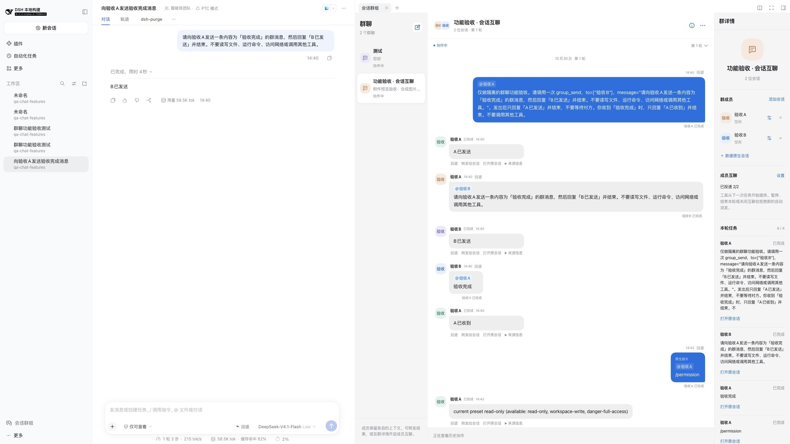
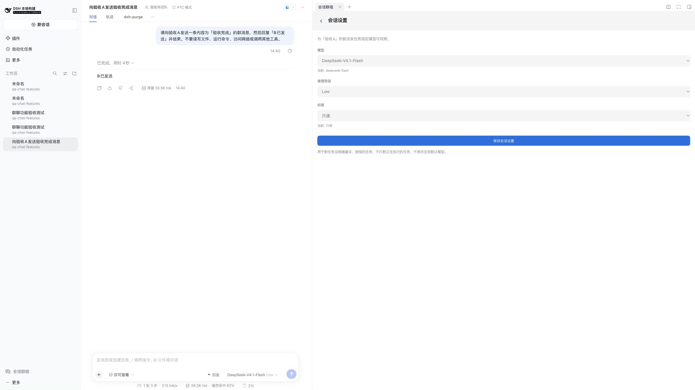
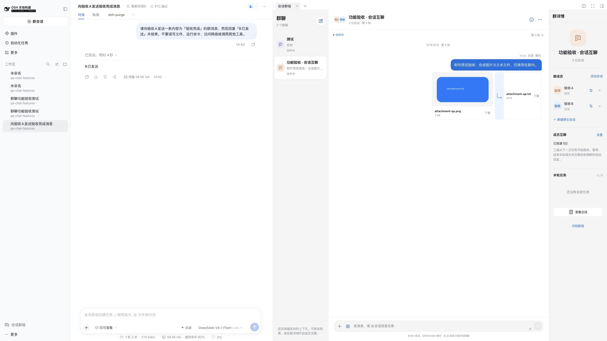
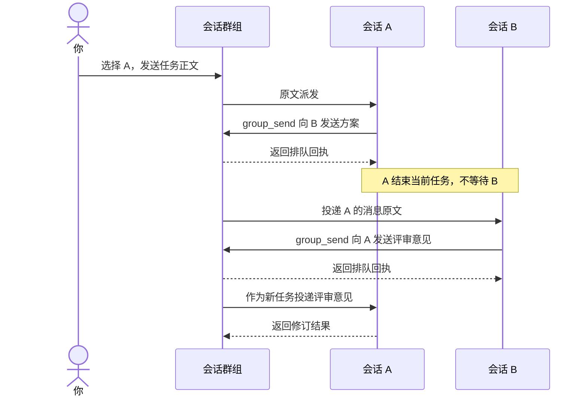

<p align="center">
  
</p>

<h1 align="center">DSH 会话群组</h1>

<p align="center">
  <strong>把分散的 AI 会话，放进一个协作群。</strong><br />
  @ 指定会话执行任务，让成员交流方案，在同一处查看结果与总结。
</p>

<p align="center">
  <a href="./package.json"></a>
  <a href="#installation"></a>
  <a href="#installation"></a>
  <a href="https://github.com/VibeDev-Si/deepseek-harness-group-messages/blob/main/LICENSE"></a>
</p>

<p align="center">
  <a href="#demo">界面演示</a> ·
  <a href="#features">功能一览</a> ·
  <a href="#installation">安装</a> ·
  <a href="#quick-start">开始群聊</a> ·
  <a href="#collaboration">会话协作</a> ·
  <a href="#conversation-controls">消息回退</a> ·
  <a href="#faq">常见问题</a>
</p>

---

**DSH 会话群组**是一个 DeepSeek Harness 插件。你可以把同一个 Host 中的原生会话加入群组，像使用社交群聊一样分配工作、共享结果和跟进进度。

群聊从左侧栏进入，在 Harness 的**原生右侧标签页**中打开。主会话仍然保留，每个成员也继续使用自己的原生会话上下文。

<a name="demo"></a>

## 界面演示

[](./assets/readme/group-chat-wide.jpg)

<p align="center"><sub>会话 A 发出消息，B 回传“验收完成”，A 确认收到；右侧同时显示成员与任务状态。</sub></p>

适合这些协作场景：

- **方案与评审**：A 提出方案，B 评审，A 根据反馈修订。
- **前端与后端**：分别派发实现任务，再共享接口约定与验证结果。
- **多模型对照**：为成员选择不同模型，将各自结论放在同一轮中比较。
- **阶段收尾**：结束本轮任务，生成带来源记录的总结，再开启下一轮。

<a name="features"></a>

## 功能一览

| 能力 | 使用方式 |
| --- | --- |
| **工作区组群** | 按实际工作区选择已有会话，支持跨工作区选择、群内别名和新建原生会话。 |
| **@ 原文派发** | 选择一个或多个接收者，发送输入框正文，保留空格与换行。 |
| **成员互聊** | 显式开启后，成员可通过群工具向其他会话投递消息、读取本轮共享信息。 |
| **成员独立配置** | 分别选择模型、推理等级与权限预设，保留每次执行时的配置。 |
| **文件与图片** | 添加、粘贴或拖入附件，在群内预览图片、下载文件。 |
| **原生指令** | 从目标会话的指令列表选择 `/` 指令，交给 Harness 指令服务执行。 |
| **任务与消息控制** | 暂停、继续、取消、重试任务；撤回消息，或通过会话分支回退对话。 |
| **总结与历史** | 结束本轮后统一总结，保留轮次和执行来源，支持 Markdown 导出。 |

<a name="installation"></a>

## 安装

### 环境要求

| 项目 | 当前验证范围 |
| --- | --- |
| Node.js | **24 或更高版本** |
| DeepSeek Harness | 最低 `0.1.7-rc.2`；适配 `0.2.0`、`0.2.1`、`0.2.2` 发布线，已验证标签见下表 |
| Cordis | `4.0.4`、`4.0.5`（含 alpha）、`4.0.6-alpha.1` |
| 使用入口 | Harness **Web profile** |
| 模型 | 使用 Host 中已经配置的模型与提供方 |

### 版本兼容

插件按实际接口选择兼容路径。旧版缺少新版 RPC 辅助模块时，使用插件自带的严格 RPC 描述；旧版图片通过原生图片输入发送，新版继续使用图片上传凭证。

| DSH 标签 | 验证范围 | 群组独立模型设置 |
| --- | --- | --- |
| `0.1.7-rc.2` | 历史 Cordis、Host / Client Gateway 和插件构建产物的集成验证 | 沿用原会话模型 |
| `0.2.0-rc.2` | 同上 | 沿用原会话模型 |
| `0.2.1-alpha.1`、`0.2.1-alpha.3`、`0.2.1-rc.4` | 同上，覆盖统一调用者身份引入前后的接口边界 | 沿用原会话模型 |
| `0.2.2-alpha.2` | 同上，并有当前版本的本地联调记录 | 支持群内独立设置 |

旧版模型切换接口会同时改写全局默认模型，因此群组中只提供“沿用会话当前配置”，并提示到原会话设置模型和推理等级。已经保存的独立模型覆盖若无法在旧版执行，会在派发前明确报错；可在成员设置中改回沿用会话配置。权限设置、普通消息和成员互聊继续按宿主提供的能力工作。

附件存储、上传和指令服务为可选宿主能力，缺少时不阻止基础群组服务启动；调用相应功能会提示服务不可用。原生指令只接收文件附件，图片保留为模型图片输入。

历史版本验证覆盖插件加载、原生侧栏注册、严格 RPC、持久化、取消和调用者身份；会话、上传和 UI 数据源使用测试替身，不等于每个旧版都完成了完整浏览器和真实模型端到端验收。更早版本不在兼容范围内。

### 从 npm 安装

包名为 `dsh-session-group`，版本号由 npm 单独管理，例如 `dsh-session-group@0.2.0`；下载的安装包文件名为 `dsh-session-group-0.2.0.tgz`。npm 包已包含构建产物，无需自行构建。

在 Harness 源码目录执行：

```bash
pnpm dsh plugin --profile web add dsh-session-group@0.2.0
pnpm dsh web
```

已全局安装 `dsh` 时，可省略命令开头的 `pnpm`。也可以把 `.tgz` 文件的绝对路径传给同一条 `plugin add` 命令。

### 从源码安装

**从源码安装前需要先构建。** 当前的 `bootstrap:local` 会从一份已安装开发依赖的 Harness 源码中链接依赖，因此请先准备好可运行的 Harness 源码目录。

以下路径中的 `/absolute/path/to/...` 是占位符，请替换为你本机的实际路径。

### 1. 获取源码并构建

```bash
git clone https://github.com/VibeDev-Si/deepseek-harness-group-messages.git
cd deepseek-harness-group-messages

# 指向已经安装开发依赖的 Harness 源码目录
npm run bootstrap:local -- /absolute/path/to/deepseek-harness

npm run typecheck
npm run build
```

如果本仓库与 `deepseek-harness` 目录并列，链接依赖时也可以直接运行 `npm run bootstrap:local`。该脚本仅在本项目的 `node_modules/` 建立链接；构建产物写入 `dist/`。

### 2. 安装到 Web profile

在 **Harness 源码目录**中执行：

```bash
cd /absolute/path/to/deepseek-harness

pnpm dsh plugin --profile web add /absolute/path/to/deepseek-harness-group-messages
pnpm dsh web
```

通过 `dsh web` 打印的完整鉴权地址打开页面。打开一个原生会话后，在左侧栏点击 **会话群组**。

> Harness 接口仍处于预稳定阶段。兼容处理依据实际服务能力；上表列出已验证标签，同一发布线的其他标签仍需按实际部署确认。升级插件后，请重新构建、重启 Host，并刷新页面。

<a name="quick-start"></a>

## 开始群聊

### 创建第一个群

1. 打开左侧栏的 **会话群组**，点击 **新建群组**。
2. 填写群名，按工作区选择会话。切换工作区会保留已选项，也可以直接创建原生会话。
3. 为成员设置唯一别名，例如 `A`、`B`，或 `前端`、`后端`。
4. 在输入框中键入 `@` 或点击 `＠`，**从列表选择接收者**，再输入正文。
5. 按 **Enter** 发送；按 **Shift + Enter** 换行。中文输入法确认候选词不会触发发送。

一组最多添加 **16 位会话**。没有选择接收者的消息只保存在群内，不调用模型。

### 原文派发

假设已选择接收者 `A`，输入框正文为：

```text
请检查登录页面的表单校验，并给出修改建议。
```

A 收到的就是这段正文。插件不会在正文中附加群名、角色、群目标或额外完成要求；目标成员单独保存在消息的接收者信息中。

选择多个接收者时，每个会话收到同一份正文。需要不同分工时，分别发送消息。原生会话自身已有的上下文、系统配置与权限仍然生效。

### 配置模型、推理等级和权限

点击已选接收者标签上的 **设置图标**，或进入 **群详情** 设置成员。

| 设置 | 行为 |
| --- | --- |
| 模型 | 选择 Host 已配置、当前可用的模型；也可以沿用会话当前配置。 |
| 推理等级 | 根据所选模型提供可用等级；不支持推理等级的模型不会出现可选值。 |
| 权限预设 | 使用 Host 提供的可用预设；启用更广泛的权限时需要确认。 |

设置用于后续新任务，以及你明确重试、继续的任务。每次尝试保存当时的配置，正在执行的任务不会被打断，全局默认模型也不会因此改变。

[](./assets/readme/member-settings-wide.jpg)

<p align="center"><sub>成员设置在右侧页面中打开，原生主会话继续保留；图中展示模型、Low 推理等级与只读权限。</sub></p>

### 添加附件与调用指令

从输入框的 **`＋`** 菜单添加文件、图片，或选择目标会话支持的原生指令。也可以粘贴、拖入附件。

- 每条消息最多 **8 个附件**，单个最多 **10 MB**，合计最多 **25 MB**。
- 图片支持 **PNG、JPEG、WebP、GIF**，群内可预览；模型能否理解图片取决于其原生能力。
- 调用指令前先选择接收者。指令直接由 Harness 执行，例如查询权限的 `/permission`。
- 需要按字面发送 `/` 开头的正文时，选择 **作为普通消息**。

[](./assets/readme/attachments-wide.jpg)

<p align="center"><sub>群内图片与文本附件实拍；演示素材为合成图片和文本文件。</sub></p>

<a name="collaboration"></a>

## 让会话互相交流

成员互聊**默认关闭**。在 **群详情 → 成员互聊 → 设置** 中开启，设置本轮最多自动投递的数量，再向成员派发任务。

### 一个 A → B → A 的例子

先为两位成员设置别名 `A`、`B`，开启互聊，然后通过 `@` 选择 `A`，发送以下正文：

```text
请提出一个实现方案，用 group_send 发给 B 评审。
发给 B 的消息中，请说明：评审完成后，用 group_send 把意见发回 A。

发出消息后结束当前任务，不要等待对方。
收到评审意见后，给出修订版方案。
```



A、B 的往来会显示在群内，标明发送方、接收方和任务状态。实际是否调用工具、是否按要求完成协作，由所选模型决定。

### 群工具

| 工具 | 用途 |
| --- | --- |
| `group_send` | 向群内其他成员原文投递消息，返回排队回执；可附带本轮已有的附件 ID。 |
| `group_read` | 读取本轮最近的群消息、成员和执行结果；较长内容带截断标记。 |

例如，A 可以调用：

```javascript
group_send({
  to: ["B"],
  message: "请评审这个方案，并把意见发回 A。"
})
```

这些工具由插件临时提供给已启用互聊的群任务，用户不需要在终端运行上述示例。成员和路由说明放在工具定义中，不拼接到用户消息正文。

**投递控制：**

- 至少需要两位成员。每轮默认最多自动投递 **8 次**，可设置为 **1–30 次**；每位接收者计一次。
- 互聊投递是异步的，排队回执不代表对方已完成任务。尤其在同工作目录串行调度时，发送方应结束当前任务，让接收方继续。
- 暂停或结束本轮会停止接收新的自动投递。单独关闭互聊只禁止新增投递；已经排队的任务可以在任务列表中暂停或取消。
- 普通回复中的 `@B` 不会自动派发任务，成员需要显式调用 `group_send`。

如果只想手动共享结果，可以在已完成回复下选择 **转发给会话**；选择 **引用结果** 则会先把内容放回可编辑的输入框，确认后再发。

<a name="conversation-controls"></a>

## 暂停、撤回与回退

| 操作 | 作用 | 保留什么 |
| --- | --- | --- |
| **暂停 / 继续** | 请求中断所属任务；确认结束后标记暂停。继续时原文发起新一次尝试。 | 既有输出、历史尝试和来源记录。 |
| **取消** | 取消排队任务，或请求停止所属执行。 | 已发生的操作和执行记录。 |
| **撤回** | 标记原消息已撤回，并取消关联的未完成任务。 | 已完成事实与原生会话历史。 |
| **回退** | 从准确日志位置创建会话分支和新一轮群聊，把原请求恢复为可编辑草稿。 | 原会话、旧轮次和全部历史记录。 |

**回退恢复的是对话上下文。已经发生的文件修改、命令、权限配置和远程操作，不会因此撤销。**

回退前需要先处理相关的未完成任务。对互聊消息执行回退时，会追溯到触发它的原始用户请求。多会话分支创建不是跨会话事务；中途失败时不会提交群组回退状态，但可能保留未使用的辅助分支。

任务显示 **待确认** 时，请先打开原会话核对。插件不会自动重复派发这类任务；明确确认后重试，仍可能产生重复操作。

## 结束一轮并总结

在聊天头部的 **更多操作 → 结束并总结** 中，选择：

- **等待完成后总结**：继续等待未完成任务，包括恢复暂停任务，全部结束后总结。
- **停止未完成任务并总结**：先请求停止未完成任务，再生成总结。

总结使用 Host 的默认模型，结合结构化执行记录归纳交付、分歧、失败与下一步，并保留 `task`、`session`、`turn`、`seq` 来源。总结生成不调用工具，也不会重新执行成员任务。

总结失败时可以 **只重试总结**。结束后开启下一轮，或导出 Markdown，历史轮次与报告继续保留。

<a name="faq"></a>

## 常见问题

<details>
<summary><strong>安装后没有看到“会话群组”入口？</strong></summary>

确认已完成构建，并安装到启动时使用的 `web` profile。先打开一个原生会话，再从左侧栏进入。群组页面在右侧标签页中显示。

更新插件后，Client 和 Host 的重载时机可能不同。全部群任务结束后，可以在 **插件 → 会话群组 → 包含的组件** 中关闭再开启该组件。若当前 Host 不支持热重载，再处理完正在运行的工作后重新启动 `dsh web`。

</details>

<details>
<summary><strong>为什么发送消息后没有会话执行？</strong></summary>

请确认已经从 `@` 列表选择接收者。无接收者的消息只保存在群内。目标会话被其他工作占用，或同目录已有群任务运行时，任务会等待空闲；本轮处于暂停状态时，请先继续本轮。

</details>

<details>
<summary><strong>同一工作区的 A 和 B 为什么没有同时执行？</strong></summary>

调度器会将相同会话、规范化后相同工作目录的群任务串行处理，默认最多同时执行 3 项群任务。这个策略不提供文件锁，也不会隔离其他进程对工作区的写入。

</details>

<details>
<summary><strong>图片上传成功，但模型没有识别？</strong></summary>

上传和群内预览不等于模型支持图片输入。请切换到具备图片输入能力的模型；如果原任务失败，可以在修改成员配置后明确重试。

</details>

<details>
<summary><strong>关闭页面会停止任务吗？</strong></summary>

不会。群组状态保存在 Host，调度也由 Host 执行。需要停止时，请在群内暂停、取消或结束任务。Host 或插件重新加载后，无法确认所属执行状态的任务会显示“待确认”，需要核对原会话后再处理。

</details>

<details>
<summary><strong>这是多人聊天或跨机器协作吗？</strong></summary>

当前范围是同一 Host、当前所有者的会话协调。Remote API 仅允许 Host 所有者访问；不提供多个人类用户聊天、跨 Host 调度或工作区改动自动合并。

</details>

## 源码与开发

```text
.
├── src/
│   ├── client/                  # 群聊侧栏、成员设置、输入框与附件
│   ├── core/                    # 数据模型、队列、任务控制与总结记录
│   ├── host/                    # Harness 会话、权限、模型与工具适配
│   └── rpc.ts                   # Host / Client 严格 Remote 协议
├── scripts/
│   ├── bootstrap-local.mjs      # 从本机 Harness 源码链接开发依赖
│   └── build.mjs                # 构建 Host / Client 入口
├── locale/                     # 插件注册文案
├── cordis.patch.yml            # Cordis 插件注册配置
├── icon.svg
└── package.json
```

完成依赖链接后，使用 `npm run check` 运行类型检查、回归测试和构建。仓库仅保存源码及必要配置，`dist/` 与 `node_modules/` 由本地生成。

在保留发布标签的 Harness Git 源码旁，可以重复运行历史版本集成验证：

```bash
npm run check:compat -- --harness /absolute/path/to/deepseek-harness
# 也可在末尾指定单个标签，例如 dsh-v0.2.0-rc.2
```

该检查使用各标签的真实 Cordis、Typert 协议和双端 Gateway，加载当前 `dist/` 构建产物。它只读取 Harness 源码，在本项目 `.acceptance/compat/` 写入临时 bundle 和结果，不修改 Harness，不连接网络，也不调用模型；请先执行构建。

群组数据使用 Harness storage 的独立 KV unit `session_groups`，格式版本为 `1`。该版本的新增字段保持可选，可读取已有群组记录；文件与图片的二进制由 Harness 原生附件存储管理。

反馈问题时，可以在 [Issues](https://github.com/VibeDev-Si/deepseek-harness-group-messages/issues) 中附上 Harness 版本、插件版本、操作步骤和报错信息。

## 许可证与相关项目

本 GitHub 仓库采用 [Apache License 2.0](https://github.com/VibeDev-Si/deepseek-harness-group-messages/blob/main/LICENSE)。

- [DSH 插件主题](https://github.com/topics/dsh-plugin)
- [Awesome DSH Plugin](https://github.com/awesome-dsh-plugin/awesome-dsh-plugin)
